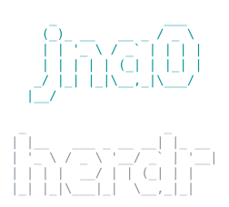

<p align="center"></p>

# herdr-jnaO-desktop-theme

A desktop theme for the [Herdr](https://herdr.dev) app: the `jnaO` layout, its `jnao-*` mods, its own `jnaO` colour theme and a reference `keys.json`, plus tooling that re-applies the theme on top of every Herdr update.

The repo is laid out like the Herdr home folder, so `layouts/`, `mods/` and `themes/` can be copied straight into it. Tooling lives in `tools/` and the Herdr sources the mods were built from live in `upstream/`; neither is part of the theme itself.

## Install

```sh
git clone https://github.com/jnaO/herdr-jnaO-desktop-theme.git
cd herdr-jnaO-desktop-theme
tools/install
```

`tools/install` copies the layout, mods, themes and `keys.json` into the Herdr home: `$HERDR_APP_HOME` if set, otherwise `~/.config/herdr-app`. It replaces the layout, the `jnao-*` mods and the `jnaO` colour theme, but never overwrites an existing `keys.json`; it prints what it skipped. The layout names `jnaO` as its colour theme in light and dark appearance, so it looks the same everywhere until you pick another theme in Settings. Then pick the layout in Herdr under Settings → Look → jnaO, or run `herdr-app do layout.switch --name jnaO`.

To uninstall, delete `layouts/jnaO.json` and the `mods/jnao-*` folders from the Herdr home.

The tools need bash, git, rsync and jq, which current macOS ships with.

## Working on the theme

Edit the mods in the Herdr home, where Herdr reloads them as you save, then copy them into the repo:

```sh
tools/export
```

`tools/export` mirrors the theme from the Herdr home into the repo: the `jnaO` layout, every cloned mod it uses (directly, or opened by another theme mod), the colour themes its `theme` field names (Herdr's built-in themes excepted) and `keys.json`. It leaves out files Herdr generates (`*.d.ts`, `jsconfig.json`), and a file deleted in the Herdr home is deleted in the repo. It refuses to run when a mod was cloned from a different Herdr version than the one in `upstream/manifest.json`.

`tools/snapshot-upstream` copies the shipped Herdr sources the theme was cloned from into `upstream/`, and records the Herdr version and their file hashes in `upstream/manifest.json`. Those sources are the base the update sync merges against.

`tools/radius <mod dir>...` sets every corner the mods draw to 2px: it rewrites `.rounded(N)` with N of 3 or more to `.rounded(2)`, leaving status dots, rings and the Herdr logo round. Running it again changes nothing.

Each modified Herdr file starts with a line naming the Herdr mod it came from, as the Apache licence asks.

## After a Herdr update

`tools/sync --dry-run` re-merges the theme onto a new Herdr release without touching the Herdr home. It compares the shipped sources' hashes in Herdr's `installed.json` with `upstream/manifest.json` and exits silently when nothing the theme was cloned from changed. Otherwise it builds a staging copy under `${XDG_STATE_HOME:-~/.local/state}/herdr-jnaO-desktop-theme/staging/`:

- each mod and the layout get a 3-way merge of the Herdr version they were cloned from (`upstream/`), the live theme, and the newly shipped Herdr source, after Herdr's own clone renames (`mods/<src>/` paths, self-opening overlay names) and the 2px corners are applied to the Herdr sides;
- JSON files are merged with their keys sorted, because Herdr reorders keys when it clones;
- new upstream files are added, files removed upstream are dropped unless the theme changed them, and the theme's own files are kept;
- `cloned_from.version` is bumped and every staged mod goes through `herdr-app check`.

It writes `report.txt` next to the staging copy, listing merged files, conflicts, failed checks and new upstream code that opens Herdr's own framed menus. It exits 1 on any conflict or failed check. `--theirs <folder>` reads the shipped sources from another Herdr home, for rehearsals.

`tools/sync` without `--dry-run` does the same and then acts on the result. It waits until Herdr has stopped writing its files for 5 seconds, and only one run happens at a time. The outcomes:

| Outcome | What happens |
|---|---|
| nothing the theme was cloned from changed | nothing; no log line, no notification |
| applied | the live theme is backed up, the merged mods and layout are swapped in and checked again, `upstream/` moves to the new Herdr version, `tools/export` runs and a local commit `Sync theme onto Herdr <version>` is made. Nothing is pushed: review and push it yourself. |
| conflict, or check failed | the live theme is untouched; the staging copy and `report.txt` stay for you to look at |
| rolled back | the merged theme failed its checks after going live, so the backup was put back |
| blocked | the repo had uncommitted changes, so nothing was applied |

Each outcome except the first appends a line to `sync.log` and posts a macOS notification. The log, the staging copy and the last five backups live in `${XDG_STATE_HOME:-~/.local/state}/herdr-jnaO-desktop-theme/`.

To recover by hand after a conflict: resolve the conflict markers in the live mod (the staged file shows both sides), copy the matching Herdr source into `upstream/` with `tools/snapshot-upstream`, and commit. To go back to any earlier theme, copy a folder from `backups/` into the Herdr home's `mods/` and `layouts/`. `HERDR_SYNC_REHEARSE_FAILURE=1` makes a run fail after going live, to rehearse the rollback.

## Privacy gate

The repo is public, so every commit passes `tools/privacy-check`. It fails when a file contains a home-folder path (macOS, Linux or Windows form), the value of `$HOME`, this machine's local hostname or the git user email. It does not look for the login name, because the theme's own `jnao-*` names would match it. The check runs:

- as a pre-commit hook: run `git config core.hooksPath tools/hooks` once after cloning;
- in GitHub Actions on every push and pull request, where only the path forms apply;
- by hand: `tools/privacy-check`.

## Documentation

Agent-facing docs: [`ARCHITECTURE.md`](ARCHITECTURE.md) is the map, and the [wiki](https://github.com/jnaO/herdr-jnaO-desktop-theme/wiki)'s **agent-docs** section has the drill-downs.

## Licence

Apache-2.0. The mods and layout are modified from Herdr's own, which is Apache-2.0; see `NOTICE`.
