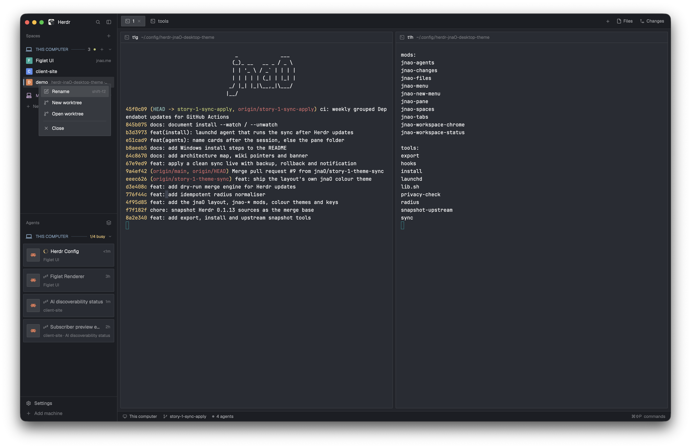

# jnaO

Herdr's own layout, tightened: a dark, square-cornered window where every machine has its own section in the sidebar, marked with a Nerd Font icon and a tinted rule. Spaces sit under their machine, agents are cards grouped by machine with a state icon next to the session name, and every corner Herdr draws (panes, cards, tab pills, menus) is 2px. The colours are Ghostty's default palette with a teal accent.



## What you see

Left to right:

- **Sidebar**, 268px wide (44 to 480px), on the `chrome` colour:
  - **Brand row** (46px, drags the window): the Herdr logo and name, plus search and sidebar buttons.
  - **Spaces** (half the remaining height, at least 90px). Each machine is a 32px header:
    - a 17px Nerd Font glyph in the machine's tint (this computer: laptop `\u{F0322}` in `ansi4` #81a2be; names containing "mini" or "studio": desktop_classic `\u{F07C0}` in `ansi5` #b294bb; any other machine: server `\u{F048B}` in `ansi3` #f0c674);
    - the machine name in upper case, 11.5px semibold, in the tint;
    - a 1px rule in the tint at 30% opacity;
    - the space count, a 6px connection dot (`ansi2` when connected), a + button and a fold chevron.

    Below the header come the space rows: an 18px letter tile (2px corners) in the space's colour, the name, and the folder or branch in grey. The active row gets the `selected` background and a 3px accent bar on its left edge, 6px in from the top and bottom, in the machine's tint. "New space there" closes each machine's list.
  - **Agents** (the other half, at least 90px). The same machine headers, with "n/m busy" in `working` colour while any agent works. Under each one are agent cards:
    - card: 9px padding, 1px border (accent when focused), 2px corners;
    - a 36px tile with the agent's icon;
    - the state icon, 14px;
    - the session name, 13.5px semibold;
    - the time in that state, on the right;
    - a grey subline: space name · tab name.
  - **Footer** (69px): Settings and Add machine.
- **Work column**:
  - **Tabs** (42px, drags the window): tabs as 29px-high pills with 2px corners, with + (new terminal or agent), Files and Changes on the right.
  - **Body**: 8px padding and 8px gap between pane cards. Each pane has a 1px `border`, turning `accent` when focused, 2px corners and a 30px header with the program and its folder. The Files / Changes panel opens on the right at 368px (280 to 900px).
  - **Status bar** (28px): machine, branch and agent count.

Colours (theme `jnaO`):

| Role | Value |
|---|---|
| background | #282c34 |
| foreground | #ffffff |
| selection | #3e4451 |
| cursor | #00868b |
| accent | #06969a |

ansi 0 to 15: #1d1f21 #cc6666 #b5bd68 #f0c674 #81a2be #b294bb #8abeb7 #c5c8c6 #666666 #d54e53 #b9ca4a #e7c547 #7aa6da #c397d8 #70c0b1 #eaeaea

## How it behaves

- **Agent states**, shown as the icon before the name, with the state word as its tooltip:

  | State | Icon |
  |---|---|
  | working | Herdr's spinner, spinning, in `working` |
  | blocked ("Needs you") | octagon `\u{F0029}` (nf-md-alert_octagon), in `blocked` |
  | done | `\u{F05E0}` (nf-md-check_circle), in `done` |
  | idle, or anything unknown | `\u{F04B2}` (nf-md-sleep), in `dim` |

  A parent agent takes its most urgent sub-agent's state; sub-agents fold under it, opened by clicking the tile.
- **Card title** is the session name: the terminal title, unless it is a path or just the program's name; otherwise the pane folder's last segment; otherwise the space name.
- **Agent sort** (the layers button): "Grouped by machine" (the default) or "Priority". In Priority each card also shows a 13px machine glyph.
- **Clicks**: a card focuses its pane. A machine header folds its list, and the fold is remembered. + on a header starts a space on that machine. Hovering a card swaps the time for a pin.
- **Menus**: right-clicking a space or a tab, and the + tab button, open the theme's own menus. Each draws its own 2px frame with a 1px `border` and a large shadow instead of Herdr's rounded popup frame. The terminal context menu shows jnao-menu's rows, inside Herdr's frame. Dragging a space shows a 2px accent line where it will land.

## Built from

- **`layouts/jnaO.json`**, cloned from Herdr's `main`. Its root sets `"theme": "jnaO"` and `"terminal_menu": "jnao-menu"`; panes have `"radius": 2`. The node tree:

  ```
  root row (canvas)
  ├─ sidebar column 268px (chrome)
  │  ├─ brand        jnao-workspace-chrome           46px
  │  ├─ sidebar-lists column
  │  │  ├─ spaces    jnao-spaces                     weight 1, min 90
  │  │  └─ agents    jnao-agents                     weight 1, min 90
  │  └─ sidebar-footer jnao-workspace-chrome {footer: true}  69px
  └─ work column
     ├─ tabs         jnao-tabs                       42px
     ├─ work-body row (padding 8, gap 8)
     │  ├─ main      active tab's panes, header jnao-pane 30px
     │  └─ panel     stack: jnao-files | jnao-changes  368px, hidden
     └─ status       jnao-workspace-status           28px
  ```

- **Mods**, each a `mod.clone` of the Herdr 0.1.13 mod named:

  | Mod | Cloned from | Changed |
  |---|---|---|
  | jnao-spaces | spaces | machine headers, accent bar, menu → jnao-menu |
  | jnao-agents | agents | machine-grouped cards, state glyphs, session-name titles, default sort |
  | jnao-tabs | tabs | menus → jnao-menu / jnao-new-menu, frameless |
  | jnao-menu | menu | own 2px frame when `props.frameless` |
  | jnao-new-menu | new-menu | own 2px frame when `props.frameless` |
  | jnao-pane, jnao-files, jnao-changes, jnao-workspace-chrome, jnao-workspace-status | pane, files, changes, workspace-chrome, workspace-status | corners only |

- **`machine.js`**, one identical copy each in `jnao-spaces/` and `jnao-agents/`: `kind(name)`, `machineColor`, `machineIcon(name, size, t)` and `machineHeader(id, name, t, {collapsed, trailing})`.
- **`herdr` calls**: `spaces()`, `machines()`, `agents()`, `panes()`, `theme()`, `shared` / `setShared`. Commands: `run("pane.focus")`, `run("space.new", {machine})`, and `openOverlay({mod, kind: "popup", frame: "none", props: {frameless: true}})`.
- **Art**: glyphs come from the "Symbols Nerd Font" that Herdr bundles. The spinner, plus, chevron and branch icons are Herdr's own `mods/workspace-chrome/*.svg`.
- **`themes/jnaO.json`**: the colours above.

## Watch out

- **Corners**: every `.rounded(N)` with N of 3 or more becomes `.rounded(2)`. Round things stay round: 6px and 7px status dots (`size(6).rounded(3)`, `size(7)…rounded(4)`), `rounded_full`, the tree connectors' `rounded_bl` and the Herdr logo.
- **Imports**: mods cannot import across folders, so `machine.js` is duplicated. Edit both copies.
- **Frameless menus**: a menu is only frameless when its opener passes `frame: "none"` and `props.frameless`. Menus Herdr opens itself (the terminal context menu frame, confirm and prompt dialogs, Settings, the palette, worktree dialogs) keep Herdr's rounded frame. No layout or mod can change that.
- **Machine kinds** are guessed from the name: anything not matching /mini|studio/i is a server.
- **Agents that report no status** (older agents, agents inside tmux) don't show up as cards.
- **The repo's `tools/`** are optional. The update sync is macOS-only, and nothing in the layout or mods depends on it.

## Done when

- `herdr-app check` passes for every `mods/jnao-*` folder, and `herdr-app do layout.switch --name jnaO` leaves `herdr-app status` with no errors.
- Each machine has a header with its glyph, tinted name and rule; the active space has a 3px bar in that machine's tint.
- Agent cards show the spinner, octagon, check or sleep glyph as the state changes, and are titled by session name.
- Right-clicking a space or tab opens a menu with square 2px corners and no Herdr frame around it.
- A screenshot shows no corner rounder than 2px except dots, rings and the logo.
